# レジ操作マニュアル（レジ係向け）

レジ係が使う画面（`/cashier`）の操作をまとめたものです。レジ 1 台で Square を使う運用が前提です。

- 画面写真のメニュー・金額・時刻・番号は**説明用のサンプル**で、本番のメニューとは違います。
- 写真の赤い枠と番号は説明用に付けたもので、実際の画面には出ません。
- 写真は `2f869469`（2026-10-17 時点の main）の画面です。画面が変わったら撮り直してください。

## 目次

1. [営業前の準備](#1-営業前の準備)
2. [画面の見かた](#2-画面の見かた)
3. [注文を受ける（現金）](#3-注文を受ける現金)
4. [Square（カード・QR コード）で受け取る](#4-squareカードqr-コードで受け取る)
5. [分けて払う（個別小計・小計分割）](#5-分けて払う個別小計小計分割)
6. [入力をやめる・直す](#6-入力をやめる直す)
7. [過去の注文（領収書・返金）](#7-過去の注文領収書返金)
8. [困ったとき](#8-困ったとき)
9. [キー操作の一覧](#9-キー操作の一覧)
10. [運用で決めておくこと](#10-運用で決めておくこと)

---

## 1. 営業前の準備

### 1-1. レジの画面を開く

トップページ（`/`）の **「レジ」**（①）を押します。開いた画面は、営業中ずっと開いたままにしておきます。

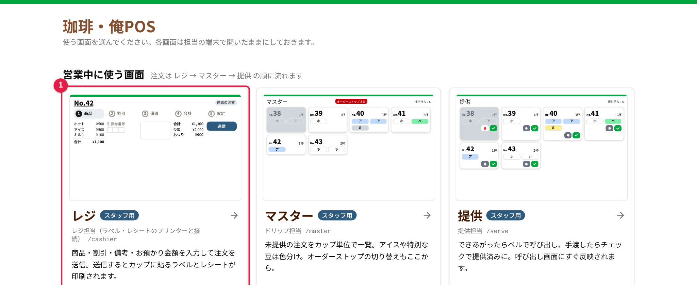

### 1-2. プリンターをつなぐ

レジは 2 台のプリンターを使います。

| プリンター | 刷るもの |
|--|--|
| ラベル用 | カップに貼るシール（抽出が要る商品があるときだけ。グッズだけの注文では出ません） |
| レシート用 | 会計のたびのレシート（下に「引換券番号」として注文番号が大きく出ます）と、求められたときの領収書 |

1. プリンターの電源を入れます。
2. IP アドレス・用紙の種類（レシート紙／ダイカットラベル）・用紙の幅は、「プリンター」の設定画面（`/printer-settings`）で決まっています（全レジ共通）。紙を変えたなどで設定を変えたときは、「テスト印刷」で刷れることを確かめてから「保存」を押し、レジを再読み込みします。

   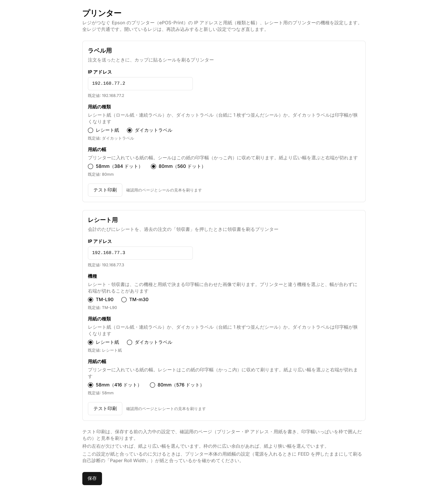

3. **iPad の場合**：Safari でラベル用とレシート用の両方の `https://<IP アドレス>`（既定は `https://192.168.77.2` と `https://192.168.77.3`）を一度ずつ開きます。証明書の警告が出たら「詳細を表示」→「この Web サイトを閲覧」を選び、レジを再読み込みします。
4. レジのヘッダーで、**「ラベル」と「レシート」の点がどちらも緑**になっていることを確かめます（→ [2-2](#2-2-ヘッダー)）。

用紙の交換は [プリンタの用紙交換](printer.md) を見てください。

### 1-3. Square 端末を選ぶ

ヘッダーの **「Square: 端末名」** を押すと「このレジで使う Square 端末」が開きます。レジの横に置いた端末を選びます。選んだ端末はこのブラウザに保存されます。

- 端末が 1 台しか登録されていなければ、自動でその端末が選ばれます。
- 「Square 端末を選んでください」と出ているときは、まだ選ばれていません。この状態ではカード・QR コードのボタンが出ません。
- 端末の追加・ペアリングは運営の作業です（`/square-devices`）。

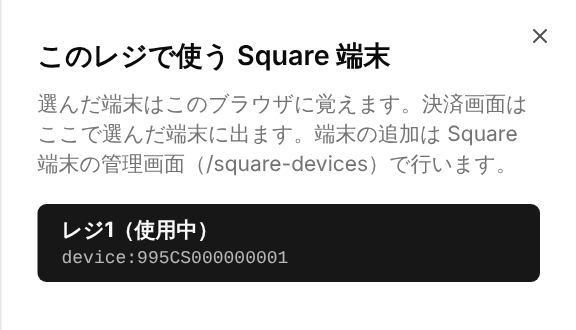

### 1-4. お客さん向けの画面を出す

レジ横のお客さん向けディスプレイで **`/cashier-mini`** を全画面で開きます。この画面は操作しません。レジで入力している内容（番号・商品・割引・合計・お預かり・おつり）がそのまま映ります。

| 入力中 | 現金で確定した直後 |
|--|--|
| 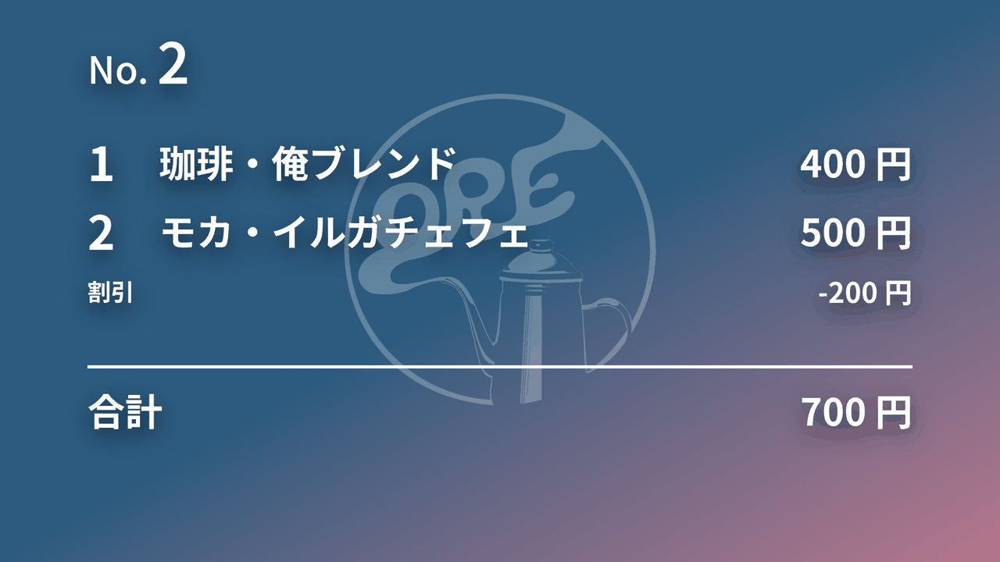 |  |

- 確定すると「ご注文ありがとうございました」に切り替わり、次の入力を始めるまでそのまま表示されます。
- Square で払ったときは、この表示に切り替わらないことがあります。
- オーダーストップ中は「しばらくお待ちください」が出ます。

### 1-5. 開店前のチェック

- [ ] レジの画面が開いていて、上の帯が**緑**
- [ ] ヘッダーの「ラベル」「レシート」の点が**緑**
- [ ] ヘッダーに選んだ Square 端末の名前が出ている
- [ ] ヘッダーの **「常に返金（キャンセルしない）」がオフ**（→ [8-5](#8-5-常に返金キャンセルしない)）
- [ ] お客さん向けの画面が映っている
- [ ] 練習で 1 件打ち、シールとレシートが出ることを確かめた

---

## 2. 画面の見かた

### 2-1. 全体

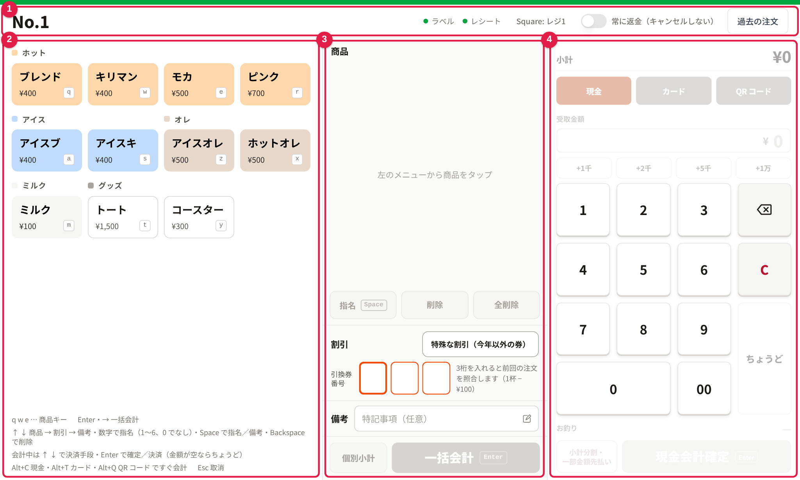

| 番号 | 場所 | 中身 |
|--|--|--|
| ① | ヘッダー | 注文番号・接続の状態・Square 端末・過去の注文 |
| ② | メニュー | 種類ごとの商品ボタン。右下の小さな文字（`q` など）がキーボードの**商品キー**です。一番下にキー操作の案内があります |
| ③ | 注文 | 入れた商品・指名・割引（引換券番号）・備考と、「個別小計」「一括会計」 |
| ④ | 会計 | 小計・決済手段（現金／カード／QR コード）・受取金額・テンキー・お釣りと、確定のボタン |

操作は「**入れる段階**（商品・割引・備考）→ **会計の段階**（受取金額・決済手段）」の 2 段階です。会計の段階では左の列が支払いの内訳に変わり、商品は変えられなくなります。

### 2-2. ヘッダー

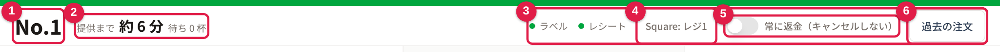

| 番号 | 表示 | 意味 |
|--|--|--|
| ① | No.番号 | 今入力している注文の番号。ふだんは自動で付きます。オフラインのときは押して手で付けます（→ [8-2](#8-2-オフラインネットにつながらない)） |
| ② | 提供まで 約 N 分・待ち N 杯 | まだ提供できていないドリンクの杯数から見積もった待ち時間。お客さんへの案内に使えます |
| ③ | ラベル・レシート | プリンターの状態。緑は接続完了、橙は接続中、赤は「〜未接続」 |
| ④ | Square: 端末名 | このレジで使う Square 端末。押すと選び直せます |
| ⑤ | 常に返金（キャンセルしない） | **本番では必ずオフ**（→ [8-5](#8-5-常に返金キャンセルしない)） |
| ⑥ | 過去の注文 | 送った注文の一覧（→ [7](#7-過去の注文領収書返金)） |

一番上の細い帯は、色で接続の状態を表します。

| 色 | 状態 |
|--|--|
| 緑 | 正常 |
| 橙 | サーバーと再接続中。画面が最新でないことがあります |
| 赤 | オフライン（→ [8-2](#8-2-オフラインネットにつながらない)） |
| 紫（「オーダーストップ中」） | マスターがオーダーストップしています（→ [8-4](#8-4-オーダーストップ中)） |

---

## 3. 注文を受ける（現金）

基本の流れは次のとおりです。

**商品キー → （指名）→ ↓ で割引へ → 引換券番号 3 桁 → （Space で備考）→ Enter で一括会計 → 受取金額 → Enter で確定**

### 3-1. 商品を入れる

商品キー（例 `q`）を押すか、メニューのボタン（①）を押します。同じ商品を 2 杯なら 2 回押します。

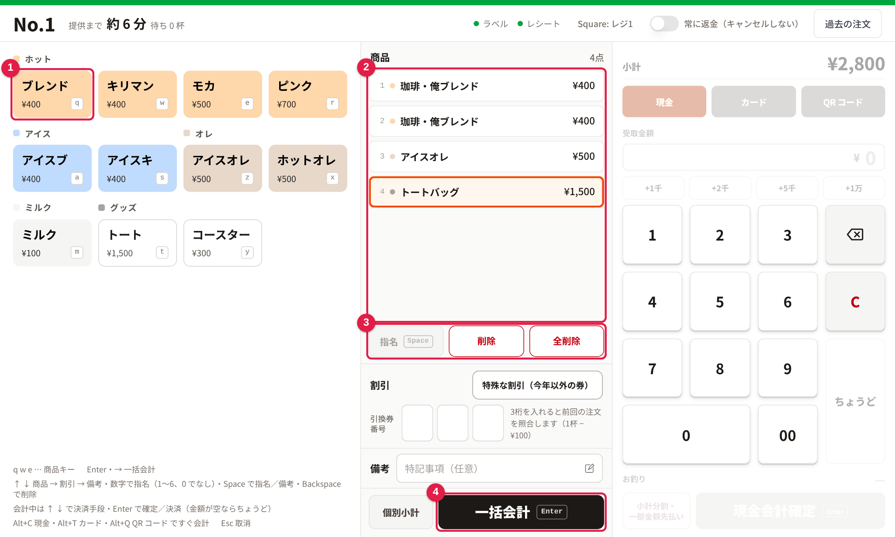

- 入れた商品は ② に並び、**最後に入れた行が選ばれた状態（橙の枠）**になります。
- **削除**：行を選んで `Backspace`（③ の「削除」でも同じ）。入れ間違えた直後なら、そのまま `Backspace` で消せます。
- **全削除**：③ の「全削除」。確認が出ます。
- **行を選ぶ**：`↑` `↓`、または行をタップします。もう一度タップすると選択が外れます。
- 「分割を推奨」が出ることがあります。抽出の要るコーヒーの種類・杯数が多い注文です。どう扱うかは [10](#10-運用で決めておくこと) を見てください。

### 3-2. 指名する

ドリッパーの指名があるときは、その行を選んで**数字キー**を押します。`1`〜`6` が 1st〜6th、`0` は指名なしです。行の下に「指名 2nd」のように出ます（①）。

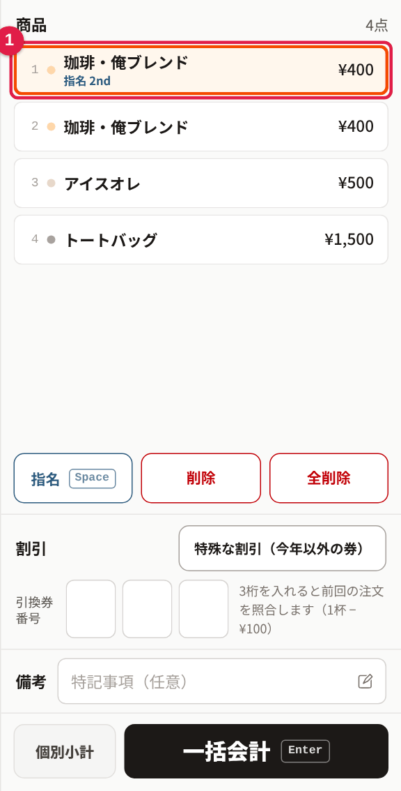

名前など自由に書きたいときは、行を選んで `Space`（または「指名」）を押します。「指名」の画面が開きます。

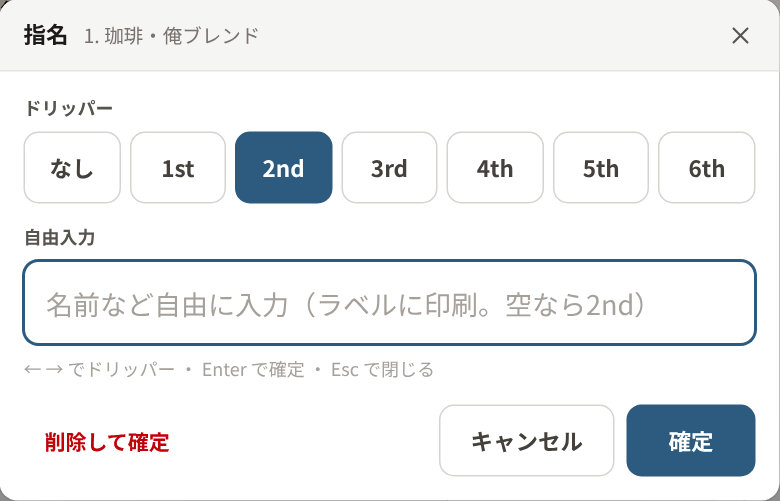

- ドリッパー（なし・1st〜6th）を選びます（`←` `→` でも選べます）。
- 「自由入力」に書いた内容はシールに印刷されます。ドリッパーを選ばないと書けません。
- 「確定」は `Enter`、閉じるのは `Esc`、指名を消すのは「削除して確定」です。
- 指名できるのは抽出が要る商品だけです（グッズなどは選んでも数字が効きません）。

> **注意**：行が選ばれている間は、数字キーは**指名**になります。引換券番号を打つ前に、次の手順で割引の欄に移ってください。

### 3-3. 割引（引換券番号）

お客さんが**前回のレシート（引換券）**を持ってきたときに割引します。1 杯につき −¥100 です。

1. 最後の行が選ばれている状態で `↓` を押し、割引の欄（3 つの四角）に移ります。四角をタップしても移れます。
2. 引換券番号を **3 桁**で打ちます。1 桁や 2 桁の番号は頭に 0 を付けます（例：No.1 → `001`）。
3. 使える番号なら緑で「N 杯分 −¥…」と出て、備考の欄に移ります。

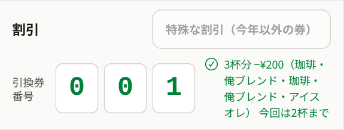

- 割引できる杯数は、前回の注文のコーヒーの杯数までです。今回の杯数のほうが少なければ、今回の杯数までになります（例：「今回は 2 杯まで」）。
- 使えない番号は赤で理由が出ます。続けて数字を打つと、1 桁目から打ち直しになります。

| 使用済みの番号 | まだ提供されていない番号 |
|--|--|
| 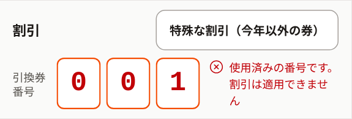 | 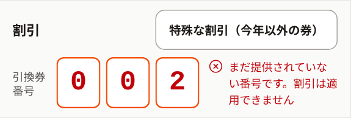 |

**特殊な割引（今年以外の券）**：以前の年の引換券を持ってきたときは「特殊な割引（今年以外の券）」を押します。1 杯分 −¥100 になります。もう一度押す（「特殊な割引を解除」）と外れます。引換券番号で割引しているときは使えません。

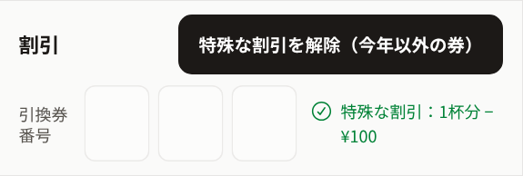

### 3-4. 備考（特記事項）

伝えることがあれば、備考の欄で `Space`（または欄をタップ）を押します。「特記事項」の画面が開きます。

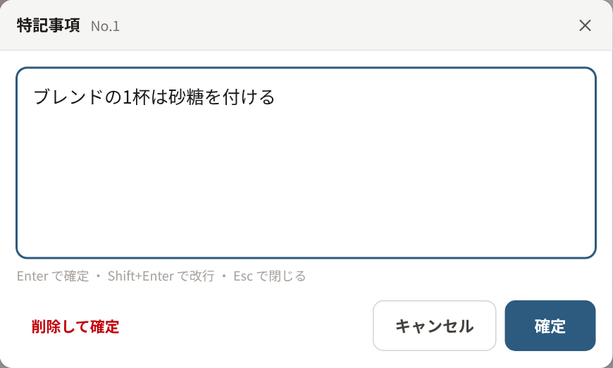

`Enter` で確定、`Shift`+`Enter` で改行、`Esc` で閉じます。書いた内容は注文のコメントとして送られます。

### 3-5. 会計に進む

`Enter`（または `→`、「一括会計」）を押すと会計の段階に進みます。

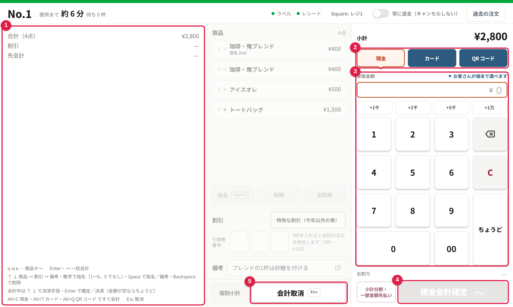

| 番号 | 中身 |
|--|--|
| ① | 合計・割引・先会計の内訳 |
| ② | 決済手段。`↑` `↓` で選びます |
| ③ | 受取金額・テンキー・「+1千」「+2千」「+5千」「+1万」。右上の「お客さんが端末で選べます」は、Square 端末にも決済手段を選ぶ画面が出ているという意味です（→ [4-1](#4-1-お客さんが端末で選ぶ)） |
| ④ | 確定のボタン（現金は「現金会計確定」、Square は「端末に送る」） |
| ⑤ | 「会計取消」（`Esc`）。会計をやめて商品の入力に戻ります |

### 3-6. 現金で受け取る

1. 受け取った金額を数字キーかテンキーで入れます。「+1千」なども使えます。打ち間違えたら `Backspace`（⌫）で 1 桁、「C」で全部消えます。
2. 「お釣り」を確かめます。足りなければ「不足 ¥…」と出て、確定できません。
3. `Enter`（「現金会計確定」）で確定します。

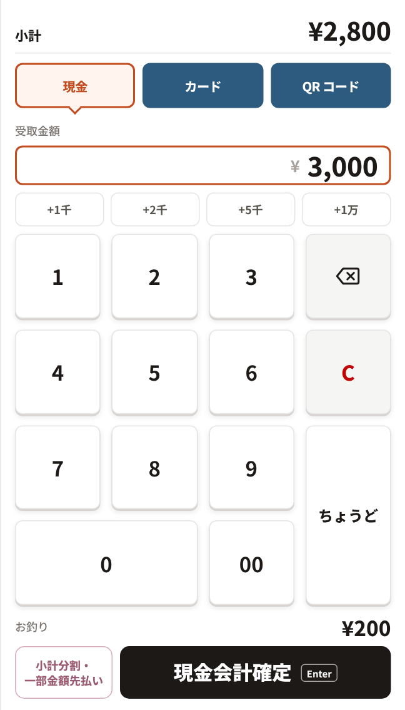

- **ちょうどのとき**：受取金額を空のまま `Enter` を押すと「ちょうど」になります。もう一度 `Enter` で確定します。
- 現金はオフラインでも受け取れます（→ [8-2](#8-2-オフラインネットにつながらない)）。

### 3-7. 確定したあと

- 画面の上に「No.N を送信しました　お釣り ¥…」が出て、ベルが鳴ります。
- **シール**（ラベル用）と**レシート**（レシート用）が出ます。
- 次の番号の空の注文に戻ります。

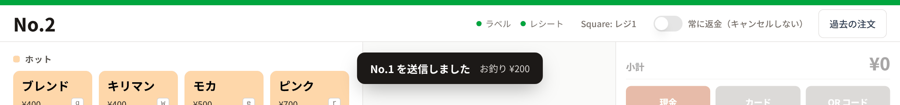

---

## 4. Square（カード・QR コード）で受け取る

使える決済手段は **カード** と **QR コード** の 2 つです。払い方は、お客さんが Square 端末で選ぶ方法と、レジ係がレジで選ぶ方法の 2 通りあります。

### 4-1. お客さんが端末で選ぶ

会計の段階に進むと、Square 端末にも決済手段（現金・カード・QR コード）を選ぶ画面が出ます。このとき、受取金額の欄の右に **「お客さんが端末で選べます」**（①）と出ます。

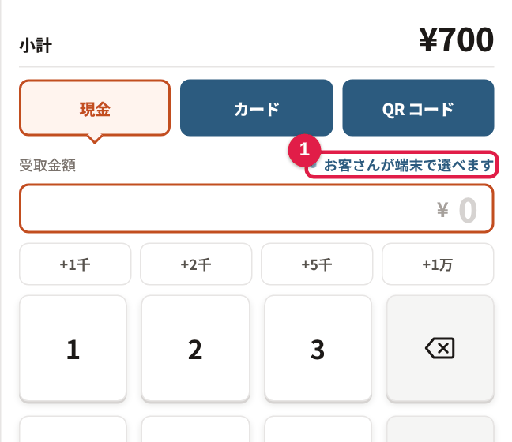

- お客さんが**カード**か **QR コード**を選ぶと、そのまま端末で支払いが始まります（→ [4-3](#4-3-端末で払ってもらう)）。
- お客さんが**現金**を選ぶと、「お客さんが端末で現金を選びました」と出ます。受取金額を入れて確定します（→ [3-6](#3-6-現金で受け取る)）。

  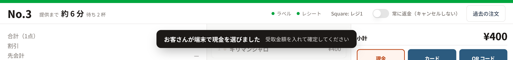

- レジ係が受取金額を打ったり、レジで決済手段を選んだりすると、端末の選ぶ画面は消えます。現金を先に受け取ったときは、そのまま受取金額を打って構いません。
- 「端末に決済手段の選択を出せませんでした」と出たときは、レジで選びます（→ [4-2](#4-2-レジで選ぶ)）。

### 4-2. レジで選ぶ

会計の段階で `↓` を押し、「カード」か「QR コード」を選びます。確定のボタンが「端末に送る」に変わるので（①）、`Enter` を押します。「カード」「QR コード」のボタンを押した場合は、その場で端末へ送られます。

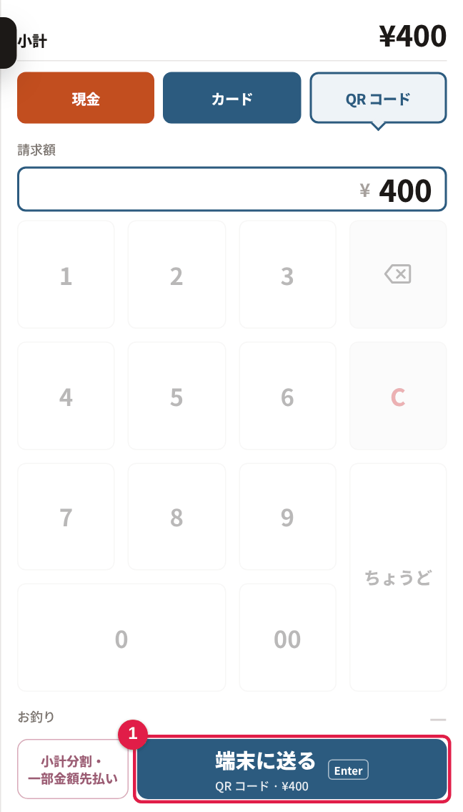

**近道**：商品を入れたあとに `Alt`+`T`（カード）か `Alt`+`Q`（QR コード）を押すと、会計の段階に進み、すぐ端末に送ります。`Alt`+`C` を押すと、現金を選んだ状態で会計の段階に進みます。

### 4-3. 端末で払ってもらう

1. Square 端末に請求額が出ます。お客さんに端末で払ってもらいます。

   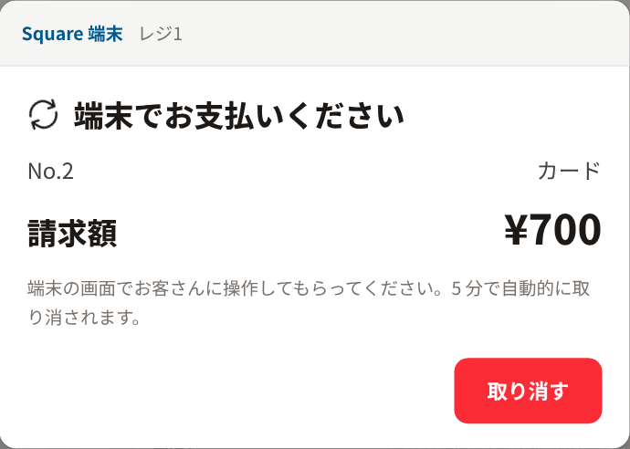

   - やめるときは「取り消す」を押します。
   - 5 分たつと自動で取り消されます。

2. 支払いが済むと、注文が自動で送られ、シールとレシートが出ます。「No.N を送信しました　Square・カード」と出れば完了です。

   

### 4-4. 決済できなかったとき

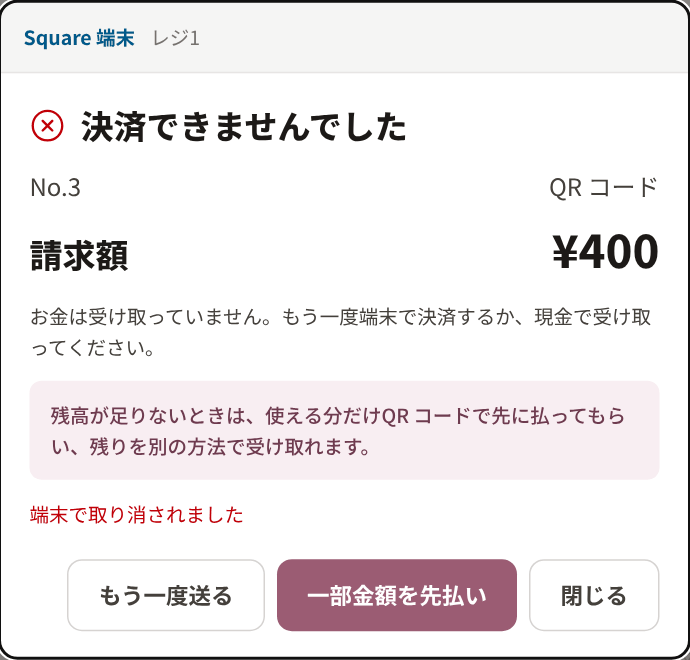

「決済できませんでした」は、**お金を受け取っていない**状態です。次のどれかを選びます。

- **もう一度送る**：同じ金額でもう一度端末に送ります。
- **一部金額を先払い**：残高が足りないときに使います。使える分だけこの手段で払ってもらい、残りを別の方法で受け取ります（→ [5-2](#5-2-小計分割一部金額先払い金額で分ける)）。
- **閉じる**：会計の段階に戻ります。「現金」ボタン（または `Alt`+`C`）で現金に切り替えると、現金で受け取れます。

Square の画面に出るほかの表示と対応は [8-3](#8-3-square-の決済のトラブル) にまとめています。

---

## 5. 分けて払う（個別小計・小計分割）

1 つの注文を何回かに分けて払うときの操作です。たとえば「この 1 杯だけカードで、残りは現金」や「QR コードの残高が足りない」といった場合に使います。

- 分けて払っている間は、ヘッダーに **「先払い中 残り ¥…」** が出ます。商品や割引は変えられません。
- 支払いのたびに、その分のレシートが出ます。全部払い終えると注文が送られ、**シールと引換券番号のレシート**が出ます。
- 注文番号は、最初のレシートを出したときの番号から変わりません。

### 5-1. 個別小計（商品を選んで先に払う）

1. 商品を入れ、「個別小計」を押します（未払いの商品が 2 点以上あるときだけ押せます）。
2. 先に払う商品を選びます。数字キーでも選べます。割引を付ける商品を変えたいときは「割引をここに」を押します。
3. 「この小計で会計」（`Enter`）を押します。

   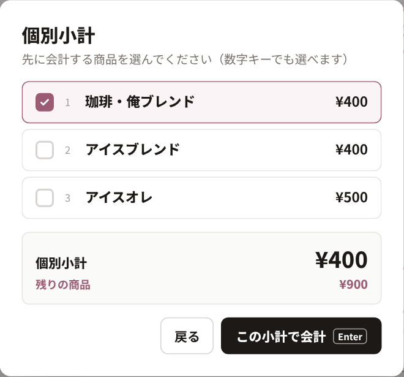

4. 選んだ分だけの会計になります。ふつうの会計と同じく、現金か Square で受け取ります。

   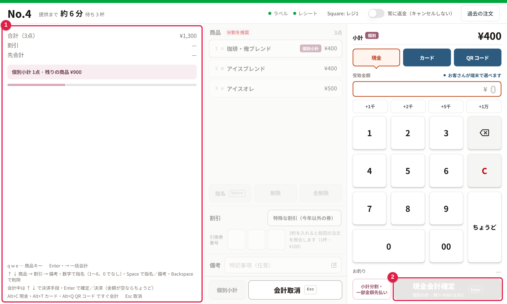

5. 受け取ると「¥N を受け取りました」が出ます。残りの払い方を選びます。
   - **残りを全て会計**（`Enter`）：残りの商品をまとめて会計します。
   - **続けて個別小計**：また商品を選んで分けます。

   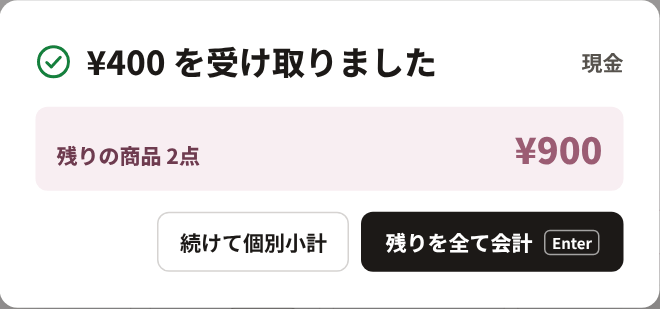

### 5-2. 小計分割・一部金額先払い（金額で分ける）

1. 会計の段階で「小計分割・一部金額先払い」を押します。
2. 先に払う金額を入れ、「この小計で会計」（`Enter`）を押します。

   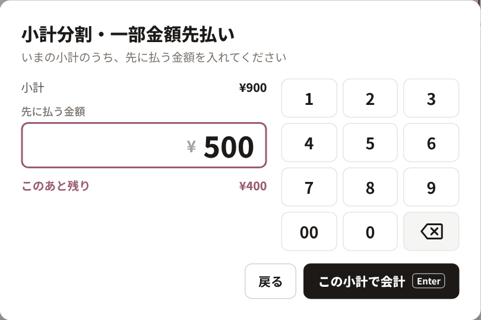

3. その金額を現金か Square で受け取ります。
4. 「¥N を受け取りました」が出ます。続けて分けるなら次の金額を入れます。金額を入れずに `Enter`（「残りを全て会計」）を押すと、残りを全部会計します。

   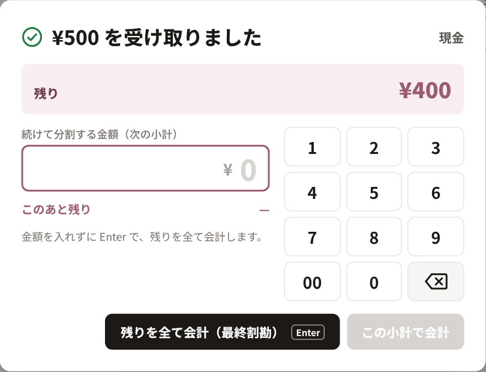

5. 全部払い終えると「会計しました」が出ます。内訳と最後のお釣りを確かめ、「次の注文へ」（`Enter`）を押します。

   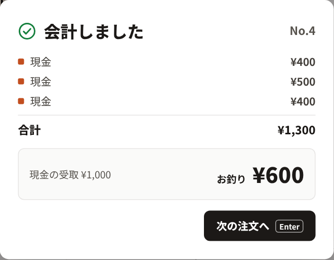

### 5-3. 先払いを取り消す

払い終える前にやめるときは、受け取った分を返します。

1. 会計の段階なら「会計取消」（`Esc`）で入れる段階に戻ります。商品の欄に「先会計 ¥… を受け取り済み」と **「先払いを取り消す」**（②）が出ます。
   - ① ヘッダーの「先払い中 残り ¥…」
   - ③ 残りの会計を続けるときは「残りを会計」

   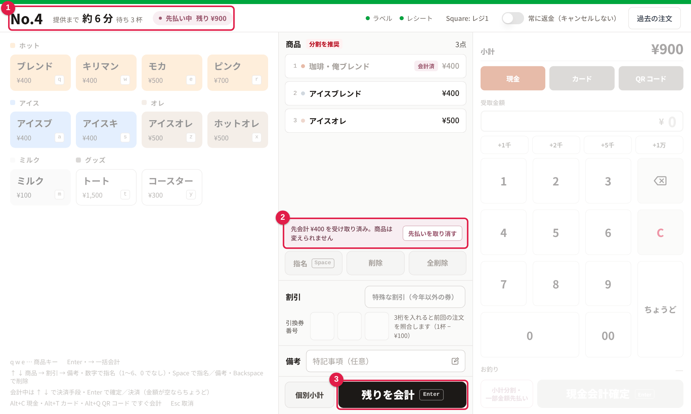

2. 「先払いを取り消す」を押すと、返金の画面が出ます。「返金する」を押します。
   - **現金の分**：お客さんに手で返し、その行の「返した」を押します。
   - **Square の分**：Square で返金されます。返金できなかったときは「もう一度」を押します。Square で返金できない支払い（交通系 IC など）は、現金で返してから「現金で返した」を押します。
   - 全部済んだら「閉じる」を押します。これで商品を変えられるようになります。
   - 会計の段階では、左の内訳の小計ごとの「×」から、その小計の分だけ取り消せます。

   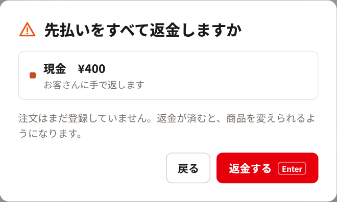

> 先払いがある間は `Esc` で注文を消せません。「先払いを取り消す」で返金してから消してください。

---

## 6. 入力をやめる・直す

| したいこと | 操作 |
|--|--|
| 商品を 1 つ消す | 行を選んで `Backspace`、または「削除」 |
| 商品を全部消す | 「全削除」（確認が出ます） |
| 会計をやめて商品の入力に戻る | 会計の段階で `Esc`、または「会計取消」 |
| 入力中の注文を全部消す | 入れる段階で `Esc`。確認が出るので「消す」を押します |

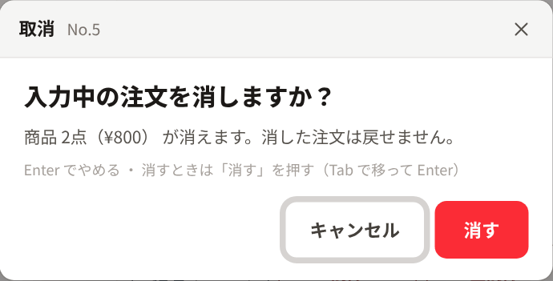

全削除と取消の確認では、`Enter` は「やめる」です。押し間違えで消えないようにしてあります。消すときは「消す」「全削除する」を押すか、`Tab` で移ってから `Enter` を押します。

**送ったあとの注文は、レジからは取り消せません。** Square で払った注文は返金できます（→ [7](#7-過去の注文領収書返金)）。現金の注文の扱いは [10](#10-運用で決めておくこと) を見てください。

---

## 7. 過去の注文（領収書・返金）

ヘッダーの「過去の注文」を押すと、送った注文の一覧が出ます。「レジに戻る」（`Esc`）で戻ります。

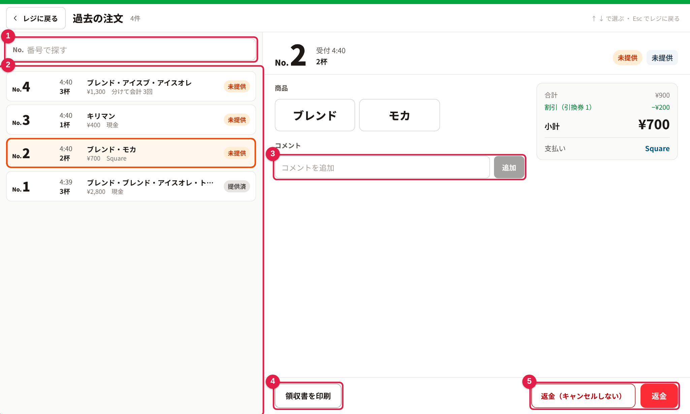

| 番号 | 操作 |
|--|--|
| ① | 番号で探す |
| ② | 注文の一覧（`↑` `↓` で選べます）。提供済・提供待ち・未提供と、払い方（現金・Square・分けて会計）が出ます |
| ③ | コメントを追加（`Enter` でも追加） |
| ④ | **領収書を印刷**。お客さんに渡す分と「店舗控」の 2 枚が出ます |
| ⑤ | Square で払った注文の**返金**（下の 2 種類） |

| ボタン | 何が起きるか |
|--|--|
| 返金（キャンセルしない） | 全額を返金します。**注文は残り**、提供も続きます |
| 返金 | 全額を返金します。Square が受け付けると**注文も消えます** |

どちらも取り消せません。確認の画面で金額と番号を確かめてから「返金する」を押します。交通系 IC の支払いは Square でも返金できません。

| 返金（キャンセルしない） | 返金 |
|--|--|
| 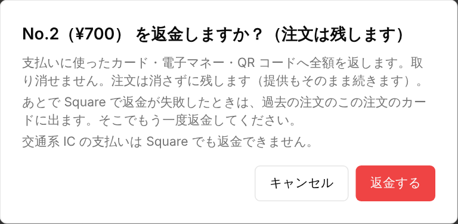 | 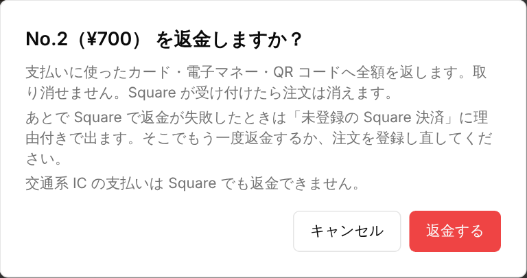 |

分けて払った注文では、Square で払った分だけが返金されます。現金で払った分は手で返します。

---

## 8. 困ったとき

### 8-1. プリンター

**つながらない**ときは、ヘッダーに赤で「ラベル未接続」（または「レシート未接続」）と出ます（①）。

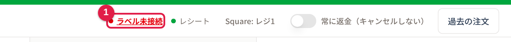

- プリンターの電源・紙・カバーを確かめます。
- iPad では、赤い「〜未接続」を押すと証明書を許可するページが開きます。許可してからレジを再読み込みします（→ [1-2](#1-2-プリンターをつなぐ)）。

**シールが刷れなかった**ときは、ヘッダーに「未印刷 N 件」と「もう一度刷る」が出ます（①）。

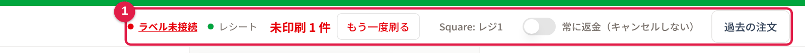

- 刷れなかったシールはこの端末に残っていて、つながると自動で刷り直されます。急ぐときは「もう一度刷る」を押します。
- 未印刷が残っている間は、ブラウザのデータを消さないでください（残っているシールが消えます）。
- レシートは刷り直されません。必要なら過去の注文から「領収書を印刷」で代わりを出します。

### 8-2. オフライン（ネットにつながらない）

上の帯が**赤**になり、番号の横に **「オフライン」** が出ます（①）。

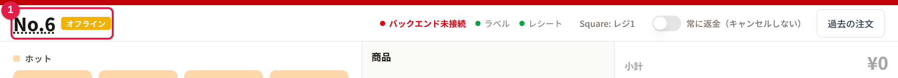

オフラインでは、**番号を手で付けないと確定できません**。Square も使えないので、現金で受け取ります。

1. 「No.番号」を押し、使う番号を入れて `Enter` を押します。

   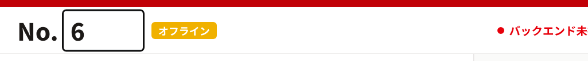

2. いつもどおり現金で確定します。注文はこの端末に溜まり、「オフライン：注文 N 件を溜めています」と出ます。プリンターにつながっていれば、シールとレシートは刷られます。次の番号は自動で 1 つ進みます。

   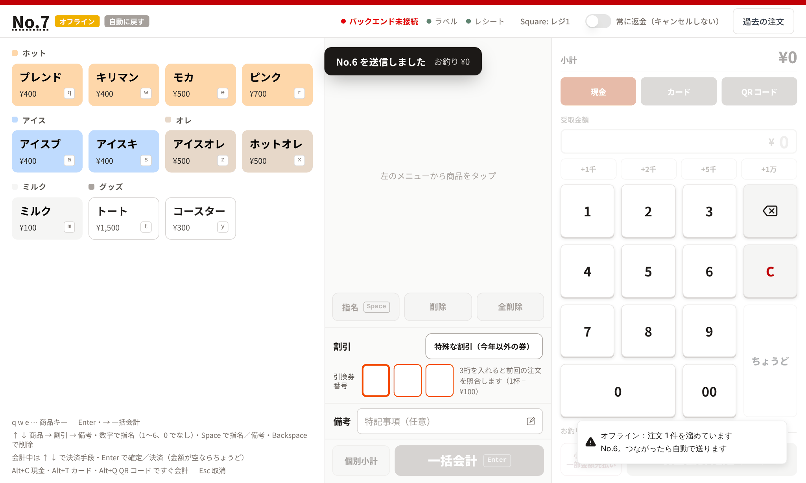

3. つながると、溜めた注文が自動で送られ「溜めた注文 N 件を送りました」と出ます。

   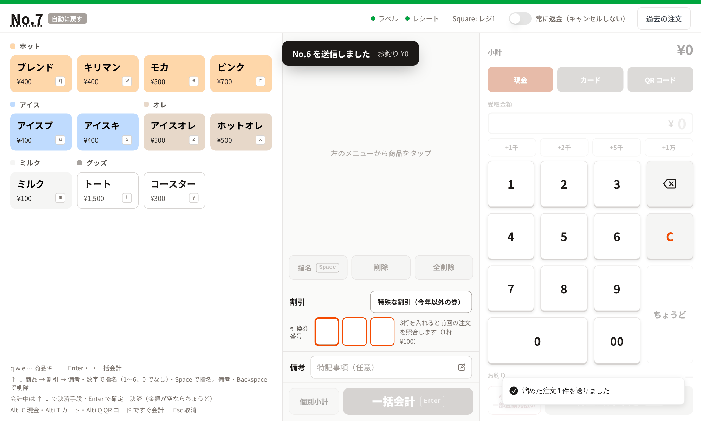

4. **つながったら、必ず番号の横の「自動に戻す」を押します。**

> **重要**：「自動に戻す」を押さないと、つながったあとも**同じ番号の注文が続けて作られます**。

- 溜めた注文があるうちは、ブラウザのデータを消さないでください。
- 「No.N の保存に失敗しました」と出たときは、そのトーストの「再送」を押します。
- ヘッダーの赤い字（「バックエンド未接続」「データベース未接続」「インターネット未接続」）は、どこにつながっていないかを表します。

### 8-3. Square の決済のトラブル

Square の画面に出る表示ごとの対応です。

| 表示 | 状態 | すること |
|--|--|--|
| 端末でお支払いください | お客さんの操作待ち | 待ちます。やめるなら「取り消す」 |
| 取り消しています | 取り消し中 | 端末で取り消されるまで待ちます |
| 決済できませんでした | **お金は受け取っていない** | 「もう一度送る」か、「閉じる」で現金に切り替えます（→ [4-4](#4-4-決済できなかったとき)） |
| お支払いが完了しました ＋「お金は受け取っています…」 | **お金は受け取った**が、注文を送れていない | **現金で取り直さない**。「注文を送信」を押します。オフラインなら、つながってから押します |
| 別の決済が進行中です | 端末で前の決済が残っている | 「進行中の決済を取り消す」 |
| 確認が必要です／結果を確かめられません | 受取額が合わない・応答がない | 端末と Square の管理画面を確かめます。責任者に連絡します |

**未登録の Square 決済**：お金は受け取ったのに注文が無い決済（決済中にレジが落ちた、など）があると、ヘッダーに赤いボタンが出ます（①）。

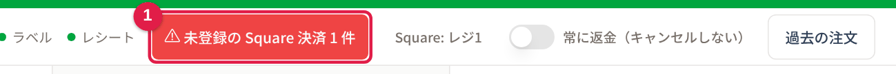

押すと一覧が出ます。

- **注文にする**：同じ商品をレジに入れてから「この決済で登録」を押します。金額が合うと押せます。Square で二重に払わせずに注文を送れます。
- **注文にしない**：「返金」を押します。

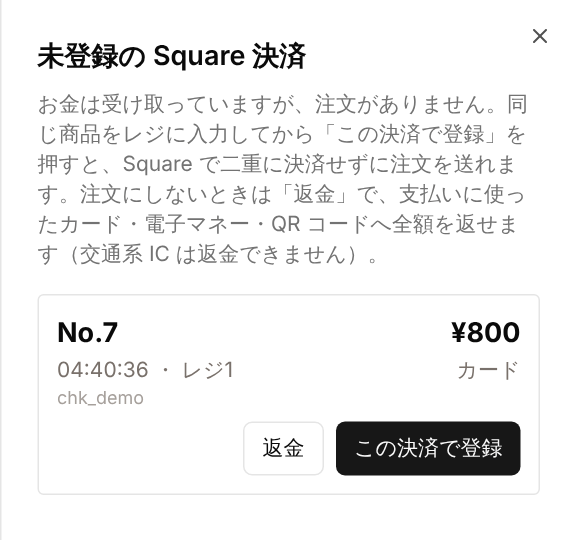

### 8-4. オーダーストップ中

マスターがオーダーストップすると、上に紫の帯で「オーダーストップ中」と出ます。お客さん向けの画面は「しばらくお待ちください」に変わります。

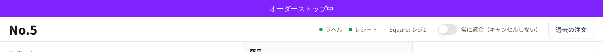

**オーダーストップ中でも、レジは注文を送れてしまいます。** 受け付けるかどうかは [10](#10-運用で決めておくこと) のルールに従います。

### 8-5. 常に返金（キャンセルしない）

このスイッチがオンだと、**Square で払われた分を、注文を送ったあとに自動で全額返金**します（注文は残ります）。オンのときは赤字になります。

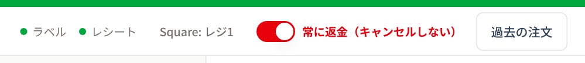

**本番ではオフのまま**にしてください。オンのまま営業すると、Square の売上が全部返金されます。決済中は切り替えられません。

### 8-6. それでも直らないとき

- レジの画面を再読み込みします。入力中の注文は消えますが、送った注文・溜めた注文・未印刷のシールは残ります。
- 直らなければ責任者に連絡します（連絡先は [10](#10-運用で決めておくこと)）。

---

## 9. キー操作の一覧

キー操作が効くのは、レジの画面でダイアログを開いていないときだけです。画面左下にも同じ案内が出ています。

| キー | 入れる段階 | 会計の段階 |
|--|--|--|
| 商品キー（`q` など） | 商品を足す | — |
| `↑` `↓` | 商品の行 → 割引 → 備考 と移る | 決済手段を選ぶ |
| 数字 | 行を選んでいれば指名（`1`〜`6`、`0` で指名なし）。割引の欄なら引換券番号 | 受取金額 |
| `Backspace` | 行を選んでいれば行を削除。それ以外は 1 桁消す | 受取金額を 1 桁消す |
| `Space` | 行なら指名、備考なら特記事項を開く | — |
| `Enter` / `→` | 一括会計（`→` は入れる段階だけ） | 現金：受取金額が空なら「ちょうど」、入っていれば確定。Square：端末に送る |
| `Esc` | 入力中の注文を消す（確認あり） | 会計取消（小計分割中なら分割をやめる） |
| `Alt`+`C` / `Alt`+`T` / `Alt`+`Q` | 会計に進む。`C` は現金を選ぶ、`T`・`Q` はカード・QR コードで端末に送る | 現金を選ぶ／カード・QR コードで端末に送る |

過去の注文では `↑` `↓` で選び、`Esc` でレジに戻ります。

---

## 10. 運用で決めておくこと

レジの機能だけでは決まらないことです。営業前に責任者が決め、ここに書き足してください。

- [ ] **現金の注文を、送ったあとに取り消すとき**の手順（レジには取り消すボタンがありません）
- [ ] **オーダーストップ中**に来たお客さんの注文を受けるか（レジは送信を止めません）
- [ ] **「分割を推奨」**が出たときに、注文を分けて打つか
- [ ] **オフライン**のときに手で付ける番号の決め方
- [ ] トラブル時の連絡先（責任者・システム担当）
