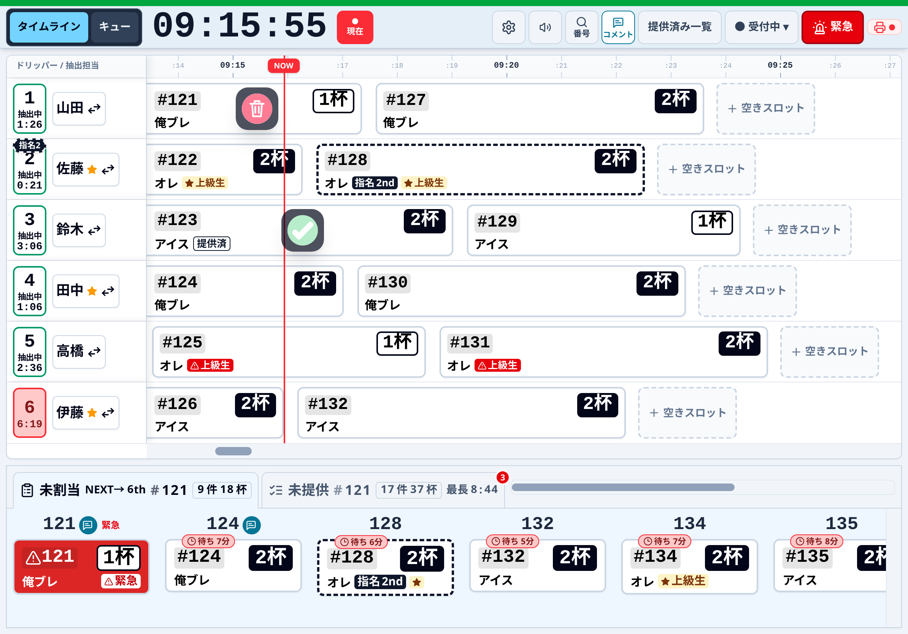
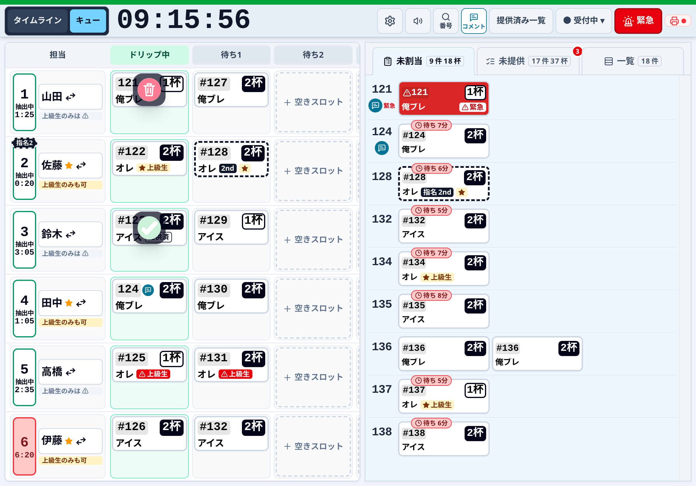
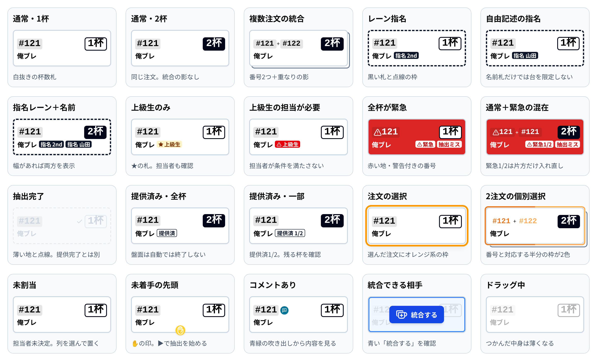
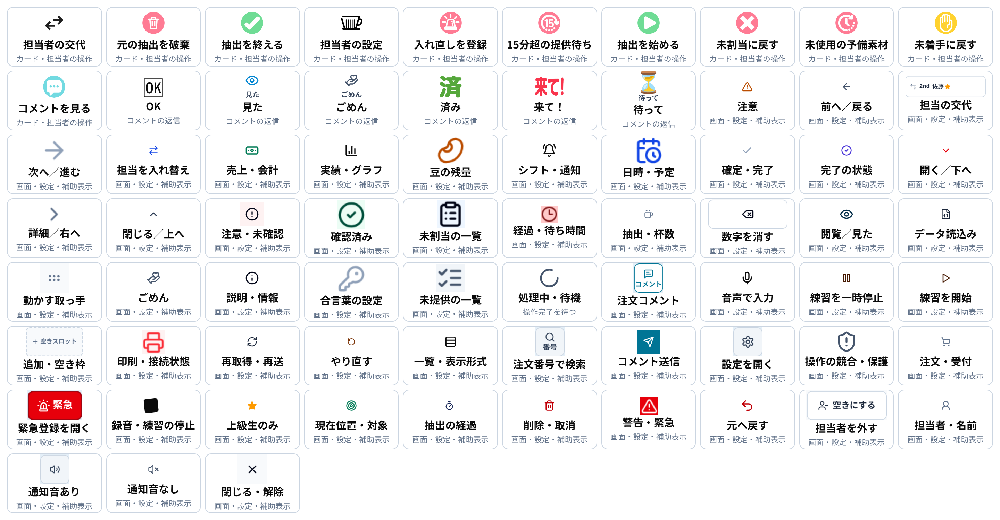
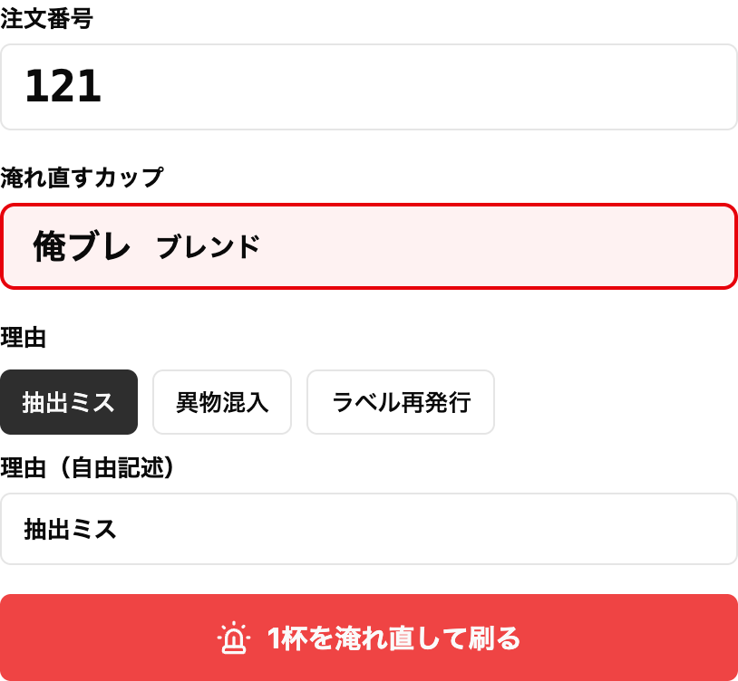
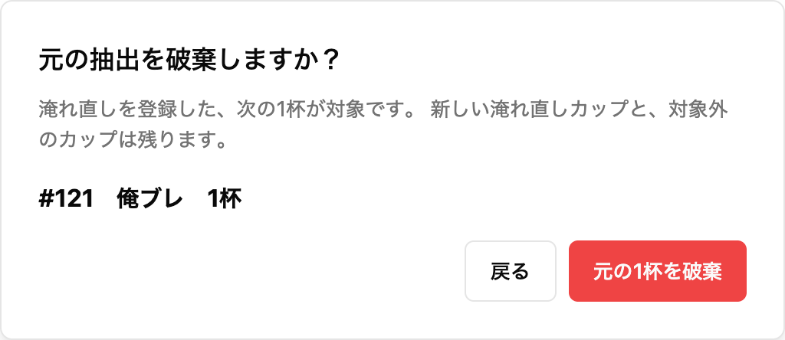
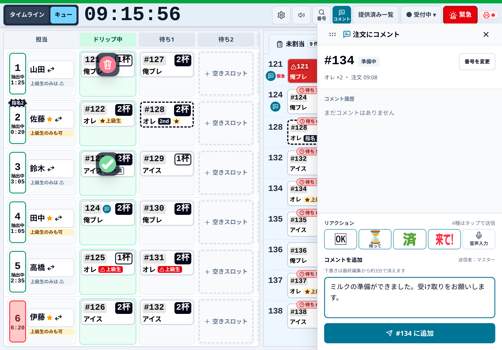
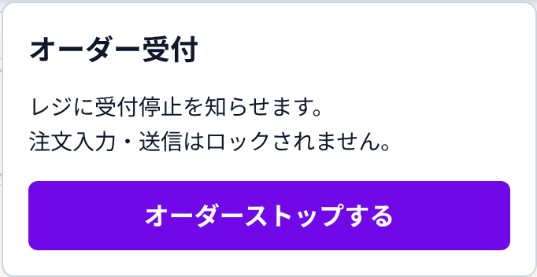
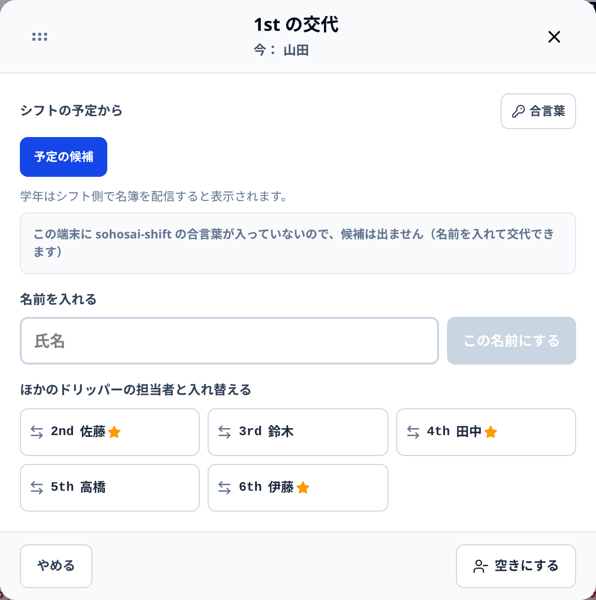
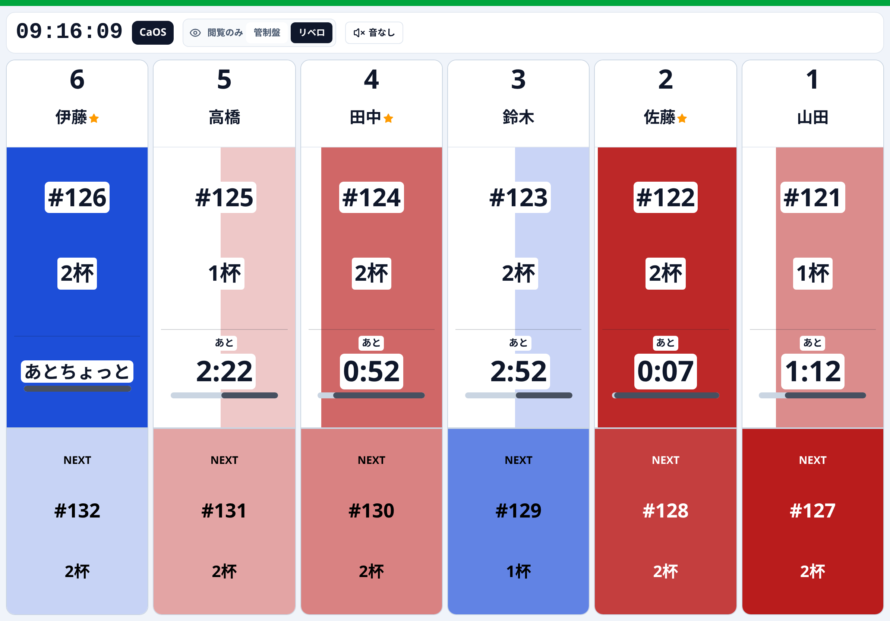

# CaOS iPad操作ガイド：PDF本文原稿

本文を先に編集・点検し、その後HTMLとPDF・SVGへ反映します。blockコメントは組版との対応です。

<!-- page:1 -->
<!-- block:p1-1 -->
## CaOS マスターシートiPad 操作マニュアル

<!-- block:p1-2 -->
何番を、誰が、どの順番で淹れるか。注文番号と現物を照らし合わせて進めます。

<!-- block:p1-3 -->
タイムライン表示｜iPad Pro 11相当・横向き 1194 × 834 CSS px。架空の注文・担当者で撮影。

<!-- block:p1-4 -->
### 開いたら確認する3点

<!-- block:p1-5 -->
接続と受付状態上部の状態を確認。接続できないときは操作を続けて連打しない。

<!-- block:p1-6 -->
担当者の番号と名前1st〜6thは抽出担当の枠。実際の担当と合わせる。

<!-- block:p1-7 -->
本番か練習か「テストの盤面です」の帯があれば練習。本番では「本番に戻る」。

<!-- block:p1-8 -->
抽出完了 ≠ 提供完了✓は抽出の終了。お客さんへ渡した記録は提供画面で行います。

---

<!-- page:2 -->
<!-- block:p2-1 -->
## 割り当てて、淹れて、次へ進める

<!-- block:p2-2 -->
「タイムライン」と「キュー」は同じ盤面。表示を替えても、注文・担当・進行は共通です。

<!-- block:p2-3 -->
キュー表示｜担当欄の右は「ドリップ中・待ち1・待ち2・待ち3」。下の未割当は、同じ注文内で最大3列に折り返します。

<!-- block:p2-4 -->
番号・商品・杯数を読む未割当のカードをタップ。割当先の1〜6を選ぶか、列へドラッグ。

<!-- block:p2-5 -->
空いている列へ置く空いた先頭へ置くとタイマーが始まる。本人が始められることを確認。

<!-- block:p2-6 -->
抽出中の後ろは待機順番を確認。待機の先頭でも未着手なら▶で開始。

<!-- block:p2-7 -->
現物を確かめて✓現在の抽出を終え、待機の先頭があれば開始する。

<!-- block:p2-8 -->
統合・移動は杯数を確認1枚は最大2杯。指名の異なる列へは移せない。長押しは詳細。

<!-- block:p2-9 -->
予定は目安です。1杯5分・2杯6分を基準に表示。残り0でも自動終了しません。

---

<!-- page:3 -->
<!-- block:p3-1 -->
## カードの見本を、実物と見比べる

<!-- block:p3-2 -->
実画面と同じ OrderCard で作った20種類の例。番号・杯数・指名・緊急の印は、色だけに頼らず確認します。

<!-- block:p3-3 -->
同じ注文の2杯は1つの番号。複数注文を統合すると番号が複数になり、後ろへ重なった影が付きます。

<!-- block:p3-4 -->
### 番号と杯数

<!-- block:p3-5 -->
黒い指名札は列の指定。★は上級生のみ。赤い上級生札は担当条件の不一致です。

<!-- block:p3-6 -->
### 指名・上級生

<!-- block:p3-7 -->
「提供済」はお客さんへ渡した状態。薄い点線の完了カードは抽出終了。別の記録です。

<!-- block:p3-8 -->
### 提供済み・完了

<!-- block:p3-9 -->
商品設定の背景色が付く場合もあります。赤地は緊急、オレンジ系の枠は注文選択。選択を解除しても、割当や抽出は取り消されません。

---

<!-- page:4 -->
<!-- block:p4-1 -->
## 操作・通知・補助画面のアイコン一覧

<!-- block:p4-2 -->
上段はカード操作の実素材と返信表示（旧表示を含む）。以降は設定・実績・通知を含む記号です。押す前に、近くの文字も確認します。

<!-- block:p4-3 -->
✓「抽出を終える」は次の待機を開始する操作。ゴミ箱のうち「元の抽出を破棄」は対象を確認して確定します。無効なボタンは押せません。「見た」「ごめん」は旧返信の表示。「未使用の予備素材」は通常画面には出ません。

---

<!-- page:5 -->
<!-- block:p5-1 -->
## 淹れ直しを作る。元の抽出は別に扱う

<!-- block:p5-2 -->
「緊急を登録」「元の抽出を破棄」「緊急を取り消す」は、それぞれ別の操作です。

<!-- block:p5-3 -->
### ① 対象の杯と理由を選ぶ

<!-- block:p5-4 -->
ヘッダーの「緊急」またはカードの緊急操作から開く。注文番号と対象カップを照合し、抽出ミス・異物混入・ラベル再発行か自由記述を選びます。

<!-- block:p5-5 -->
### ② 元の抽出を破棄するときは確認

<!-- block:p5-6 -->
淹れ直しがある元カードにはゴミ箱が出ます。対象番号・商品・杯数を確認して確定。新しい淹れ直しや統合相手は残り、次の待機は自動開始しません。

<!-- block:p5-7 -->
混在は最大2杯通常と淹れ直しを同じカードへ統合できます。「緊急1/2」は片方だけが淹れ直しです。

<!-- block:p5-8 -->
ラベル再発行だけなら元のコーヒーを捨てる操作ではありません。破棄候補には出しません。

<!-- block:p5-9 -->
刷れないとき未印刷を確認。設定済みならレジが代理印刷します。取消済みの緊急は再送対象から外れます。

---

<!-- page:6 -->
<!-- block:p6-1 -->
## 番号を選んで、短く確実に伝える

<!-- block:p6-2 -->
盤面にカードがない注文・提供済みの注文にも、本日の注文番号からコメントを追加できます。

<!-- block:p6-3 -->
「コメント」→注文番号か最近の注文を選択。入力中の例です。送信先の番号を最後にもう一度確認。

<!-- block:p6-4 -->
ヘッダーのコメント新着の数字は未確認の知らせ。総注文数ではない。

<!-- block:p6-5 -->
宛先を選ぶ番号入力か最近の一覧から選択。カードを動かしても宛先は固定。

<!-- block:p6-6 -->
スタンプ・音声・文字スタンプはタップで送信。音声は内容を確認。自由記述は追加ボタンで送る。

<!-- block:p6-7 -->
送信成功を確認失敗時は下書きが残る。通信復帰後に確認して再送する。

<!-- block:p6-8 -->
下書きは最終編集から約3分で消えます。再読込・日付変更・練習開始でも保持をあてにしないでください。

---

<!-- page:7 -->
<!-- block:p7-1 -->
## 受付を切り替える。担当者を引き継ぐ

<!-- block:p7-2 -->
受付の停止と、すでに受けた注文の抽出は別です。担当交代も自動では行われません。

<!-- block:p7-3 -->
### 受付中・受付停止中をタップ

<!-- block:p7-4 -->
状態を読み、確認パネルで停止・再開を確定。ほかの端末で変わった場合は最新状態を再確認します。注文入力・送信・抽出をロックする機能ではありません。

<!-- block:p7-5 -->
### 担当者名・交代から選ぶ

<!-- block:p7-6 -->
番号と名前、上級生の印を確認。予定表は候補で、時刻になっても自動では替わりません。交代しても、その列のカードは残ります。

<!-- block:p7-7 -->
接続できないとき受付切替は予約・自動再送しません。状態を読み直してから判断。

<!-- block:p7-8 -->
上級生のみのカード交代後の担当が条件を満たすか確認。赤い警告を見落とさない。

<!-- block:p7-9 -->
交代の前に口頭確認抽出中の現物、待機の順、淹れ直し、未提供の長い注文を引き継ぐ。

---

<!-- page:8 -->
<!-- block:p8-1 -->
## 困ったときは、状態を確認して止まる

<!-- block:p8-2 -->
表示・状況

<!-- block:p8-3 -->
確認すること

<!-- block:p8-4 -->
「未送信」が残る

<!-- block:p8-5 -->
連打しない。端末内の操作を確認し、接続復帰を待つ。他端末の操作と競合したら最新の盤面を確認。

<!-- block:p8-6 -->
プリンターが赤い

<!-- block:p8-7 -->
電源・接続・証明書・未印刷を確認。代理印刷の有無をレジへ確認。重複ラベルは現物と照合。

<!-- block:p8-8 -->
「あとちょっと」・要確認

<!-- block:p8-9 -->
予定超過だけで✓を押さない。淹れ忘れ・押し忘れ・現物を確認して進める。

<!-- block:p8-10 -->
ボタンがない／押せない

<!-- block:p8-11 -->
閲覧専用画面か、接続待ちか、送信中かを確認。未着手・抽出中・完了では操作が異なる。

<!-- block:p8-12 -->
赤い通知の数字

<!-- block:p8-13 -->
新着コメント・長時間待ちなどの未確認分。開いて消えても、注文や提供が完了した意味ではない。

<!-- block:p8-14 -->
別のタブでも開いた

<!-- block:p8-15 -->
操作用は1つのタブにする。別端末へ映すだけなら閲覧専用の入口を使う。

<!-- block:p8-16 -->
順番や状態が分からなくなったら、勝手に提供済み・破棄にしない。注文番号と現物を照合し、運営責任者へ確認します。

<!-- block:p8-17 -->
### 見るだけの入口

<!-- block:p8-18 -->
リベロ表示。各担当の抽出中・残り・NEXTを確認。割当操作はできません。

<!-- block:p8-19 -->
### 毎回、最後に見る4点

<!-- block:p8-20 -->
- 注文番号と杯数は合っているか

<!-- block:p8-21 -->
- 指名・上級生・緊急の条件は合うか

<!-- block:p8-22 -->
- 押すボタンは「開始・終了・破棄」のどれか

<!-- block:p8-23 -->
- 送信・印刷の結果を確認したか

<!-- block:p8-24 -->
この資料はiPad相当のブラウザーで撮影した統合確認版です。実機・実プリンターでの接続や本番デプロイの確認を保証するものではありません。

---
